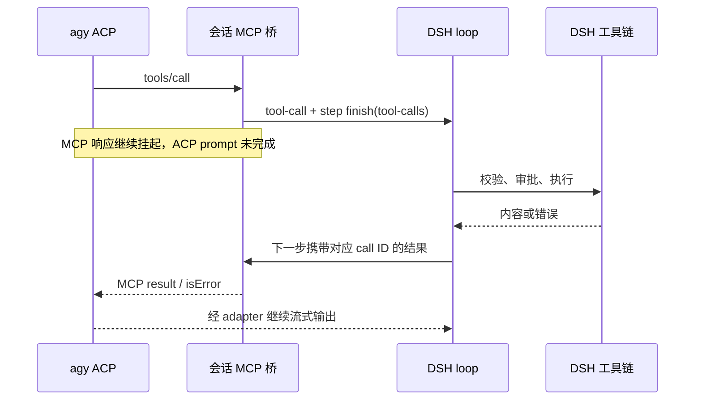

# 上下文、MCP 与 skill 的接入设计

状态：已有离线实现和 MCP SDK 联测，尚未经过真实 CLI 生成及 DSH 集成验收。当前能力与限制见[实现状态](STATUS.md)。

首版使用自定义 agent 正文承载最新完整 system，不重复 append。Host 在原始 `llm/stream` 读取 Agent Loop 身份并通过 AsyncLocalStorage 跨 Runtime 投影传递；当前工具走 Runtime 的完整当前集合模式，不声明 native `toolUpdate`，以免 eager 桥重新公开已移除工具。图片在原始请求处明确拒绝。

挂起时的新增 user/context（含 skill additionalContexts、运行时快照与用户 steering）以有版本的 `dsh-continuation` 信封附在对应 MCP 结果后，保留原 role/source 和后缀顺序，工具原始内容不改、不重复加载 skill。它是文本来源投影，物理角色仍为 tool；只有旧前缀、system、工具与路由未变时才允许。

## 1. 三个通道共同的边界

DSH 发起每步模型请求时提供有效 system、派生消息历史、可见工具 schema、会话身份和取消信号。插件负责投影；工具与 skill 的权威目录仍是 DSH，不在 agy 里再安装一套。

| 通道 | DSH 输入 | agy 侧入口 | 权威来源 |
|---|---|---|---|
| 上下文 | system、消息、动态注入、图片 | agent 提示 / system append / ACP prompt 内容 | DSH 历史与装配 |
| MCP / 工具 | 当前 `tools` 及之后的工具结果 | 隔离配置中的 eager MCP 桥 | DSH 工具注册和执行链 |
| skill | 目录、`skill` 工具、显式手势注入 | 上下文和同一工具桥 | DSH skill provider |

这些是逻辑通道，不要求 DSH Core 新增同名服务或修改其 Slot 系统。

## 2. 上下文通道

### 2.1 system

- 从完整请求中解析当前有效系统提示，不只查看 `options.system`：DSH loop 通常把 system 放在 messages 中。
- 候选方案使用自定义 agent 的正文承载固定 DSH 指导，或采用 `systemPrompt.append`；两者与 `excludeDefaultComponents` 的组合必须先验证，再选定一种作为唯一事实源。
- 同一段系统提示不能同时写到 agent 正文、append 和用户 prompt，避免三份重复。
- system 变化时重建执行单元，直到已经证明存在同等语义的原位更新机制。
- 不把 system 文本包个 XML 标签就宣称获得了原生 system 角色优先级。

### 2.2 消息和来源

| 内容 | 初次建立 / 全量重建 | 正常增量 |
|---|---|---|
| 用户输入 | 按顺序完整保留 | 每条都发，即使两次内容相同 |
| time/runtime 上下文 | 保留当前有效值与来源 | 只有已知 producer 的相同快照可去重 |
| skill 目录 | 当前有效替换目录 | 有变更或清空时显式替换 |
| assistant 文本/思考 | 历史描述，角色标记清楚 | 只有确认为同一 ACP 输出时不重发 |
| 历史 tool-call / tool-result | 过去的记录，明确不得重执行 | 当前 pending 的结果走 MCP 回填 |
| 外部 provider 产生的消息 | 作为历史材料完整重放 | 若破坏前缀则重建，不假定 ACP 已知道 |

不能仅以“最后一个 user 角色”判断当前用户任务；动态上下文也可能是 user。优先使用 DSH 已提供的来源语义，未知来源保留，不伪造为用户授权。

去重必须区别“内容相同”与“状态相同”：例如目录 A→B→A 仍需发送最后一次 A；不能对所有上下文做永久内容去重。

### 2.3 前缀一致性

每个会话代次记录：

```text
DSH 会话身份 / 请求用途
已提交输入前缀指纹
实际交付的 assistant 输出指纹
当前有效 system 指纹
工具快照指纹
模型、档位、CLI 版本和配置指纹
在途 prompt 与 pending call 集合
```

指纹只用于同一运行时的一致性，不把正文或无盐敏感内容 hash 写入可共享日志。

前缀、路由、工作目录、system 或工具集变化后，先排空在途工作，再用 DSH 历史重建。成功返回桥结果但未最终提交 DSH 的情况需要明确记录，不能靠文本推测是否已执行。

### 2.4 图片与其他内容

仅在当前路由与 ACP 都声明支持时，经 DSH 附件服务读取实际图片内容。附件丢失、offload 或格式不支持要如实报告；不自己抓 URL 或用生产文件路径代替附件权限。

资源链接与 skill 引用按来源语义保留，不让 agy 原生 read_resource 绕过 DSH。音频、视频、生成图片不在首版范围。

## 3. MCP / 工具通道

### 3.1 只代理现有 DSH 工具

DSH 中的 MCP 工具已经是普通可见工具，例如 Blender 连接也由 DSH 持有。桥只转发声明与调用结果，不复制 MCP URL、凭据或启动命令给 agy。

工具集应以当前 DSH 已批准的集合为准。若提供可选子集过滤，必须同步工具指导与 skill 依赖；默认不能无提示删掉用户需要的工具。

### 3.2 声明构造

1. 将 DSH 工具名映射为 MCP 可用名称，维护无碰撞双向表；不能因清洗名称把两个工具合并。
2. 将 input schema 转为 SDK 接受的等价声明。无法保留 `$ref`、联合类型或 required 等约束时报告兼容错误，不静默删约束。
3. 在隔离 `config/mcp_config.json` 中把已发布工具逐项设置为 eager，避免让 agy 自己读 schema 文件。
4. `tools/list`、配置 eager 列表和 DSH 工具快照必须一致；不能展示 A、执行 B。
5. 工具集变化的首版策略是重建，不先依赖未验证的 `tools/list_changed` 支持。

全局配置路径的正向结果仅针对隔离根目录；不能写到真实用户全局配置。当前样本未证明 eager 必须同时依赖配置和 `_meta`，故作为待消歧组合记录。

### 3.3 挂起和续轮



- 多调用按桥 call ID 匹配，支持乱序；同一 ID 的重复回填不能重复执行。
- ACP 工具进度只用于展示，**只有鉴权后的桥 tools/call 才能产生 DSH 执行请求**，避免重复触发。
- DSH 拒绝作为 `isError` 回填；用户取消则撤销授权、终结 pending，并排空整个 prompt。
- 部分结果、批次边界与迟到调用需有有界队列；不能只靠任意短暂 sleep 判断“所有调用已到齐”。

### 3.4 原生残留和 resources

模型报告残留 `manage_task`、`list_resources`、`read_resource` 是尚未解决的问题，不给予默认豁免。桥不注册 MCP resources，DSH 资源访问只经 DSH 自身的资源工具回填；仍需验证 agy 是否有其他资源提供者和后台任务副作用。

若无法去除这些原生声明，应返回用户评估是否接受，不把当前目标自行降级为“拒绝执行就够了”。

## 4. skill 通道

| DSH 行为 | 适配规则 |
|---|---|
| `<available_skills>` 发布 | 保留目录说明、可调用性、替换语义；不能混入 agy skill |
| 模型调用 `skill(name)` | 走 DSH 工具桥，仍由 DSH provider 判断名称和权限 |
| 返回 `<skill_content>` | 原样保留来源与资源导航，通过 MCP 工具结果交回 |
| 用户显式 `/name` 注入 | 按 DSH 已装配内容发送；不能再让 agy 把它扩展成自己的命令 |
| skill 引用文件 | 经 DSH read 等工具，不能开放 agy 的原生读取 |
| skill 动态安装/卸载 | 让 DSH 更新目录；必要时同步工具快照或重建 ACP |

skill 正文加载一次与永久有效不是一回事；新用户手势、版本变化、目录撤销都必须遵守 DSH 的既有契约。

## 5. 辅助请求和失败

标题、压缩、旁路提问等用途独立命名空间，不能误接主对话的工具续轮。对不回喂工具结果的辅助请求，桥出现 tools/call 应主动报错和收束，不能占住 worker 等待永远不会来的下一步。

参数无法映射、内容不支持或当前纯净配置失效时明确停止。不能为了保持“看起来可用”而切回默认 agy agent、重新加载原生工具或绕过 DSH 审批。
