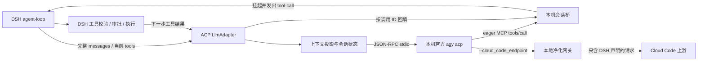

# 整体设计

日期：2026-11-15，2026-11-16 修订（纯净性改由出口网关机械执行），时区 Asia/Shanghai。实际进度、验证边界与剩余门槛以[实现状态](STATUS.md)为准。

## 1. 产品目标与当前门槛

插件名与目录固定为 `dsh-antigravity-acp`。在 DSH 模型选择器中提供 Antigravity 订阅模型，实际生成由本机官方 `agy acp` 完成，账号使用 CLI 当前登录。DSH 是上下文、工具和会话记录的权威方。

用户明确不接受“原生工具仍对模型可见，只在执行时拒绝”。因此首要验收是**模型可见声明的纯净性**，其次才是工具能否执行。不得退回仅靠 strict 审批的方案并宣称目标达成。

配置层无法达标：自定义 agent 加 `excludeDefaultComponents` 之后，线上仍有 `manage_task` 等原生声明，系统提示仍是完整 Antigravity 身份提示（见[研究记录](RESEARCH.md) §10）。因此纯净性改为**机械保证**：CLI 的所有模型请求被 `--cloud_code_endpoint` 强制指向本进程的 loopback 净化网关，网关逐条改写出站请求体，无法解析即拒绝转发。产品声明相应收窄为“出口请求被净化”，不再声称“CLI 内部无原生能力”。

## 2. 范围

### 2.1 必须实现的职责

- 发现本机官方 CLI，记录版本与可执行文件指纹，能力与已验证版本匹配后才允许使用。
- 插件拥有独立 gemini 根目录、应用数据和空代理工作区；不把真实项目设为 agy 的可直接访问工作区。
- 本机 loopback MCP 桥将本会话的 DSH 工具声明提供给 agy，实际调用返回 DSH 执行链。
- 保留来源信息的上下文投影、skill 加载、多轮缓存、取消和错误收束。
- 身份、配置或历史不一致时停止或受控重建；不自动重发不确定状态的任务。

### 2.2 不实现的职责

- OAuth、`authenticate`、登录/登出、账号池、凭据读取/复制/换发。
- 程序下载、更新、修改二进制或向生产 agy 目录写配置。
- 直连 Cloud Code 私有接口、伪装 UA、TLS 指纹、直连 fallback。
- Antigravity 的浏览器、子代理、swarm、工作流、skill、规则或生产 MCP 继承。
- 把上下文占用量伪装成计费 token、成本或缓存命中率。

## 3. 组件关系



接入 DSH 的 LLM adapter 扩展点，保留 DSH agent-loop。ACP server 在这里是外部执行引擎；把它投影为模型提供方是适配，不代表 ACP 已变为原生模型 API。

## 4. 模块划分（拟议）

| 模块 | 职责 |
|---|---|
| `host/index` | 注册 adapter、生命周期与状态服务，不修改全局 agent 工厂 |
| `runtime/cli` | 明确可执行路径、版本检查、受管子进程，不经 shell 拼接命令 |
| `runtime/isolation` | 私有目录创建、配置原子写入、所有权标记、退出后清理 |
| `runtime/profile` | agent、MCP、strict 配置；缺失或回退默认 agent 时拒绝运行 |
| `protocol/connection` | ACP 请求/通知、双向 ID 空间、取消、帧长上限与 EOF |
| `adapter/context` | system 与历史投影、来源保留、增量判定 |
| `adapter/continuation` | ACP prompt 和多个 DSH step 之间的挂起/回填状态机 |
| `bridge/server` | MCP transport、会话授权、工具清单和挂起调用 |
| `bridge/schema` | 名称映射、schema 可表达性验证，不静默放宽约束 |
| `catalog` | 当前账号公布的模型、档位与能力，不猜 entitlement |
| `runtime/gateway` | loopback 净化网关：删非桥接声明、重写系统提示、fail-closed 不转发 |
| `diagnostics` | 仅 allowlist 元数据、受限日志、证据摘要 |
| `client`（后置） | 配置与连接状态；不提供登录按钮或原生模式开关 |

以上是职责划分规划；现有源码按实际职责合并实现，精确模块和验证边界以[实现状态](STATUS.md)为准。

## 5. 进程与隔离

每个 DSH 会话代次创建一个独立执行单元：

```text
<插件私有根>/<随机执行单元>/
  owner.json
  workspace/                       # 空代理工作区
  gemini/
    config/agents/dsh-model/agent.md
    config/mcp_config.json         # 仅本单元 DSH 桥，含短期随机 token
    dsh-acp/settings.json
```

- 目录 0700、配置 0600；拒绝复用未知所有权、软链接或跨根路径。
- 使用 `ctx.subprocess` 的当前安装契约启动和释放，不直接接管其他进程。
- `HOME` 保持原值供官方程序访问当前登录；显式覆盖 `--gemini-dir`、相对 `--app-data-dir` 与进程临时目录。
- 环境变量使用凭据清理后的最小集合，不能把另一路 API key 注入从而意外改变计费来源。
- 官方进程可能刷新系统 keyring；插件不触碰凭据不等于系统认证状态绝对不变化。
- 当前活跃登录定义为“启动官方进程时取得的 CLI 身份”。运行时切号的传播未验证，不自动重绑在途会话。
- 第一版一进程一会话、全局有界串行排队；后续再引入多 worker。`--process-per-session` 不是独立配置目录的替代品。

## 6. 净化网关与候选配置

纯净性由网关保证（见 §1）。下面的候选配置仍要使用，但它的作用是**减少原生能力与提示注入面**，不是达标手段：即使配置退化，网关也会删掉多出来的声明。

```text
请求体改写规则（每次 streamGenerateContent）：
- request.tools[].functionDeclarations 只保留 mcp_dsh-bridge_ 前缀且名字属于本单元已公布集合的项
- 删空的分组删除；没有剩余声明时整个 tools 字段移除
- requestType !== "checkpoint" 时 systemInstruction = 本轮 DSH 系统提示
- 解析失败 / 结构异常 / 无 DSH 系统提示 / 网关异常 → 4xx 且不连接上游
- 不落盘 body 与 token，只累计声明名数量；令牌藏在 127.0.0.1 随机路径里
```

下面是历史成功探针的候选基线，不是已认证生产配置。

```yaml
---
name: dsh-model
description: DSH model shell.
mainAgent: true
subagent: false
hidden: true
excludeDefaultComponents: true
inheritMcp: true
tools: null
skills: []
plugins: []
---
Answer the user directly and concisely. Use any tool provided to this session when useful.
```

这里显式保留 `tools: null`：历史脚本对 JSON null 的判断有误，成功用例实际写出的就是该值；省略字段或写 `[]` 的等价性未确认。不得把它悄悄改写成其他形式。

隔离根中的“全局” MCP 配置仅指**该执行单元的全局**，不是用户生产全局目录：

```json
{
  "mcpServers": {
    "dsh-bridge": {
      "serverUrl": "http://127.0.0.1:<port>/mcp",
      "headers": { "Authorization": "Bearer <临时授权值>" },
      "tools": { "<桥工具名>": { "eager": true } },
      "timeoutSeconds": 120
    }
  }
}
```

- 桥先绑定随机端口，确定 token，写好配置，**最后启动 agy**；探针曾在进程启动后写配置，这种竞态不保留到实现里。
- 历史成功用例同时设置了 session `_meta.antigravity.eagerMcpServers`，没有单独排除其作用；初版实验应保留两者并随后拆分验证。
- `session/new` 使用空代理工作区，`mcpServers: []`；后续若发现其他同样有效路径再补证据，不宣称其他路径永远不可用。
- `toolPermission: strict` 加客户端拒绝未知请求作为纵深措施；不靠未验证的 deny 规则承担核心保证。
- 默认 agent 回退、残留原生工具、额外 skill 或来源不明工具是阻断项。不能仅靠模型自述做每次启动的安全认证。

## 7. 上下文与工具循环

详细映射见[三通道设计](CONTEXT-MCP-SKILLS.md)。关键不变量：

1. DSH 完整消息历史为准，ACP 会话仅是可丢弃的派生缓存。
2. DSH system 保持指令层级；`systemPrompt.append` 只证明普通 ACP 会话中有行为效果，与上述自定义 agent 组合仍需测试。
3. 当无法保留消息语义、工具 schema 或图片时，明确报不支持，不把它们悄悄压成普通用户文本。
4. agy 发起桥调用时挂起 MCP 响应；adapter 发出 DSH tool-call 并结束该 step；下一步带来结果后才释放该响应。
5. 此间 ACP `session/prompt` 仍未结束。不能把“DSH step 结束”误当“ACP prompt 完成”。
6. 历史全量重建里的工具轨迹只作为过去记录，绝不执行或补交旧副作用。

## 8. 状态机

```text
新建 → 配置就绪 → 握手 → 身份/agent 校验 → 空闲
空闲 → 活跃 prompt → 有工具挂起 → 等待 DSH 结果 → 活跃 prompt
活跃 prompt → end_turn → 空闲
任意在途状态 → 取消/故障 → 排空 → 释放
```

同一会话不重叠 prompt。每个桥调用分配插件自有 call ID，并绑定执行单元、会话、prompt、工具快照和代次。MCP JSON-RPC ID 不能当作跨连接全局唯一 ID。

system、工具集合、历史前缀或路由变化时：若有挂起调用，先取消排空并记录执行状态；之后再决定是否可安全重建。不在桥等待结果时创建一个新 prompt 代替续轮。

## 9. 工具权限和协议边界

- 桥只发布当前会话 `tools` 的可见子集，保持工具指导与 skill 目录一致；缺依赖时不能保留误导性提示。
- 生产桥用正式 MCP SDK，不采用历史探针“任意工具名都返回成功”的简化实现。
- 端口仅 loopback、token 随机 32 字节、会话代次轮换、Host/Origin 与会话路由校验、体积上限；凭 token 也只能调用已发布工具。
- 权限请求中的展示 title、参数和子串都不是身份凭证。只有已验证的规范工具映射可作为是否回 `allow_once` 的线索；实际执行仍须通过桥鉴权和 DSH 工具链。
- 未知工具、旧代次、重复 ID、未发布工具不得进入 DSH。
- 不暴露 agy MCP resources；DSH resources 使用 DSH 的共享资源工具经桥调用。此举减少原生资源入口，但不证明残留 `read_resource` 无风险。
- 不给原生 `manage_task` 设默认无害例外。用户要求模型看不到这些工具，未去除即不达标。

## 10. 模型、参数与计量

| 项目 | 策略 |
|---|---|
| provider | 暂拟 `antigravity-acp`；实现前核对重名，不覆盖其他插件 |
| 模型/思考强度 | 来自会话实时配置；精确设置失败就报错，不静默降级 |
| 可用性 | 仅对已测试版本宣称兼容；不把“版本更高”视为自动兼容 |
| 输出、温度、stop | ACP 未证明有等效通道，不能声称生效；adapter 不声明虚假的输出默认值，显式不支持项按 DSH 契约处理 |
| 上下文 | `usage_update` 仅用于当前占用/窗口，容量未知时保持未知 |
| 计费 token/成本 | 无权威值则不报，不拿累计上下文差值估算 |
| 原直连 429 | 不自行重建 Cloud Code envelope，但也不承诺官方路径没有 429 |

标题、压缩等辅助调用必须单独分区，不分享正在挂起工具的主 prompt。第一版若无法明确支持这些用途，就返回可读的不支持错误，不修改全局 DSH 设置来绕过。

## 11. 取消、失败和销毁

- DSH 的取消信号发送 ACP cancel，撤销桥授权并等待 prompt 与工具终态；超时后通过受管子进程执行退出升级。
- 使用 session close、stdin EOF、等待退出，再按需信号升级；未知退出状态不复用目录。
- 429、断流、超时、权限拒绝和工具已执行后连接丢失都不自动重放整个 prompt。
- 已执行但结果未确认时上报“不确定”，不承诺普遍的 exactly-once。
- 重启后不自动恢复不确定的挂起副作用。第一版不做跨进程 durable resume，先安全重建空闲历史缓存。
- 删除前核对绝对路径、所有权和进程退出；不得使用按时间清扫整个生产目录的策略。

## 12. 日志、安装与退出标准

日志默认只记方法、状态、耗时、数量和脱敏结构；不持久化 prompt、tool 参数/结果、token、邮箱或官方日志全文。诊断启用不得改变出站调用次数。

实现前按[参考资料](REFERENCES.md)加载 DSH skill、用 Cordis Inspect 核对 Service/Event/Config，准确模式与方法由 Inspect 返回决定。Config 构造期字段采用普通配置重启；若使用 volatile，按当前契约解引用和响应变化。

后续安装只通过 Plugin Manager，在隔离实例验收后再按用户指示操作目标 profile。不编辑 profile manifest，不替换当前会话模型，不删除旧插件。发布门槛见[测试计划](TEST-PLAN.md)。
