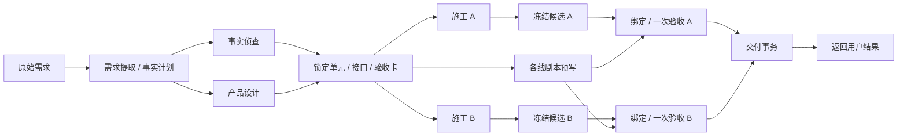

# DSH 逐线交付插件：实现设计稿

状态：待评审，尚未实现。暂名 `dsh-delivery-orchestrator`。配套：[角色提示词与协议](<delivery-orchestrator-prompts.md>)。

## 1. 产品约束

唯一业务输入是用户原始需求；引用的仓库、文件和外部资源由插件在用户当前 DSH 宿主允许的范围内取证。插件的生产职责只有：把需求变成可执行的单元图，分配施工，逐线取证和判定，并返回对应结果。它不负责实验指标、实验报告、HTML 报告或选择 headless。

必须明确三层：

1. **被测插件**：在用户当前的 DSH 有头会话中正常运行。它不读取“自己正在被实验”的信息，也不依赖监控器才能交付。
2. **DSH 执行宿主**：有头时是用户正在使用的 DSH；实验时只是把同一插件装入隔离的 DSH headless 进程。headless 是启动方式，不是插件能力，也不是生产依赖。
3. **实验底座**：插件之外的 driver、事件采集、指标计算、HTML/报告和重放脚本。它可以启动 headless、保存 NDJSON、读取插件公开结果并计算 TTA/成本/质量，但插件不调用它、不生成它的报告，也不为了实验改变业务行为。

切分按独立可用的交付结果，不按文件、技术层或 Agent 数。每个单元一名实施 owner、一张冻结验收卡，并声明它与其他单元的接口和交集。软件以编译或装载为入场门；功能回归用真实完整用户旅程，不写散装单测。研究、数据、文档使用其真实下游和可信来源，不硬套浏览器。没有适用的可验证路径时明确人工验收或 `NO_DECISION`。插件不是任意命令执行器，也不默认部署、发布或改外部资源。

### 两张图，而不是一张混合图

生产插件只关心下面这张图：



实验底座在图外运行：`headless driver → 同一插件入口 → 读取插件结果/事件 → 外部统计与 HTML 报告`。它不是生产拓扑，也不能成为插件的必需节点。


| 自有接口 | 行为 |
| --- | --- |
| `delivery_run({request})` | 在当前 DSH 宿主中显式提交原文，幂等范围为调用身份和请求 ID；返回插件生成的结果、状态和制品引用。宿主可以是 GUI，也可以是实验底座启动的 headless。插件不区分二者。 |
| `delivery_checkpoint({unitId,kind,detail?})` | 只作用于授权单元。服务端按调用身份找到 run、attempt、lease；模型不能提供路径、URL 或候选作为授权。`ready_for_acceptance` 持久化冻结意图、停止该尝试的写入、入队，立即返回短 receipt，不等编译、E2E 或判定。合法施工完成事件可触发同一幂等操作。 |
| `delivery_status({runId})` / `delivery_cancel({runId})` | 读状态或取消本人的 run。施工、Judge 等角色没有停止和改权限的工具。 |

建议包布局：`shared/{schema,events,wire}`、`host/{service,scheduler,store,admission,artifacts}`、`host/acceptance/{compile,scenario,runner,judge}`、`adapters/{browser,cli,data,document,research}`、`prompts/v1`。`Host apply(ctx, config)` 由 `dsh.bundle.patch` 加载。插件运行配置只描述角色路由、工具范围、并发、交付策略和判定模式；实验 driver、指标计算、HTML/report、headless 启动器属于插件外的实验底座。Opus 5.5、GPT 6.2 Sol、GPT 6.1 Sol、GPT 6 Astra、DS41 均为可选部署配置，不是内置路由或可用性承诺；严禁静默换模型。

## 3. 生成契约和调度

形状由版本化 JSON Schema 验证；语义由 Host 验证跨引用、归属、可达、无环、写范围及权限。角色不执行调度。主图不设重试环。

| 对象 | 最低契约 |
| --- | --- |
| `SpecV1` | `requirements, design, factGates, partitionDecision, units, nodes, edges, acceptanceCards, deliveryRule, gaps`；每项必需需求从用户原文定位到卡和证据。 |
| `FactGate` | `id,question,sourcePolicyId,evidencePredicate,affects`；验证来源及事实内容后解锁，仅阻塞受影响节点。 |
| `Unit/Node/Edge` | 单元有 `id,outcome,kind,owns,consumes,requirementIds,cardId`；节点有 `role,inputRefs,outputKinds,resourceClass,readyWhen`；边含 `from,to,artifactKind,predicate`。公共底座需声明确切消费关系。 |
| `CardV1` | `id,unitId,livePreconditions,orderedSteps,checks,visualCheckpoints,sourcePolicyId`；检查含 `requirementId,mode,expected,observationSource,critical,evidenceLimit`；mode 为 `deterministic|semantic|manual`。 |
| `Candidate` | `id,contentManifestHash,baseHash,specHash,runtimeFingerprint,dependencyDigests,ownerAttempt`；内容地址化，V1/V2/V3 是待验输入。 |
| `RunSnapshot` | `runId,candidateId,cardHash,scenarioHash,runnerVersion,attemptId,observedFacts,checkpoints,artifactRefs,exitReason`；是一条旅程输出。 |
| `Decision` | `evidenceHash,policyVersion,verdict,reasonCode,source,requestId?`；由绑定引用校验 run、候选和卡。 |

需求分解先产出待查事实与设计工作。产品发现与来源侦查并行，有界面才启用 `ui-ux-pro-max`；未知使某条线受阻时，已锁定接口、卡和需求映射的其他单元可先施工。新事实不能静默改写锁定卡，须递增版本并记录影响。全局 Spec 锁定时，如有必需需求无证据路径就拒绝；可保留有明确责任人的人工验收项，但不能冒充可自动通过。

节点 `PENDING → READY → RUNNING → SUCCEEDED|FAILED|BLOCKED|CANCELLED`；验收 `QUEUED → ELIGIBILITY → RUNNING → DECIDING → PASS|FAIL|NO_DECISION|STALE`。事件驱动，按施工、编译、浏览器、上游和判定分别限流，优先关键路径兼顾饥饿。一次纯 DSL 格式修正；实测业务失败发证据，不隐式循环修复重判。

**版本与复用。** Checkpoint 原子撤销受控写租约；制品复制/封存完成后才允许下游启动，构建和使用环境固定。后续施工在其他租约/工作区。v0 只接受当前集成候选的证据；共享构建、接口、数据或配置改变使相关结论过期，在新候选就绪时触发对应线，不补设统一 Reviewer。以后只有能证明执行闭包、运行条件、接口都等价时，才复用未变单元证据，不能靠“代码 diff 很小”推断。显式跨单元行为仍需要自己的业务卡。无法证明隔离就保守重放，重放代价进入报告。

## 4. 角色权限与 Hooks

| 角色 | 能做 | 不能做 |
| --- | --- | --- |
| Spec / 产品 | 读原文、可信事实及授权技能，提交结构化设计 | 写业务、派工、改权限、宣布通过 |
| 侦查 | 只读核对获准来源；适用时用 Playwright CLI | 改业务、写线上数据、扩大来源 |
| 施工 | 读授权基线，写所属产物，发 checkpoint | shell、网络、浏览器、测试、改卡、子派工及 PTC/MCP 透传 |
| 剧本 | 读冻结卡、接口、有限 locator 投影，提交 DSL | 执行整条 E2E、任意 JS/命令、改业务或降低验收 |
| Runner / Judge | Runner 按可信适配器采证；Judge 只读精简证据 | Judge 无工具、写入、查资料或停进程能力 |

施工权限由作用域工具 + 单调 Guard + 文件工具租约和真实路径检查共同执行；禁止越界路径、symlink 和目录逃逸。`restrict` 仅限制继承的全局工具，局部注册和其他执行渠道必须单独禁止。项目编译可能执行项目代码，由 Host 使用运营批准的 argv、独立环境、文件挂载和网络约束运行；未证明所需 OS 隔离就不执行不可信代码。临时 `DSH_HOME` 不是安全沙箱。

| 已核实 DSH 契约 | 用法 |
| --- | --- |
| `agent/pre-step`（waterfall） | 受管 Agent 在下一步检查租约、预算和取消；不合法返回 `{kind:'reject'}`，合法 `return next()`。不在这里判断业务或阻塞验收，也不声称能中止已在飞生成。 |
| `agent/turn-stopping`（serial） | 短且幂等地记录边界。不是验收入口、timer 或等待后台的机制；不通过循环 steer 保活。 |
| `ctx.tools.register/restrict/guard`；`tools/result`（emit） | Scope 注册和单调拒绝；`tools/result` 是只读冻结结果，用于观察和归因，不承担业务落盘。 |
| `llm/stream`（waterfall） | 读取受管调用的最小快照，旁听 `usage/finish`，原样转发；Loop 请求冻结，不改写。旁路请求不递归采集。 |
| `ctx.subagents.startActivation`、activation `result/dispose()` | Native 使用受管本地子级和 `delivery:'caller'`；先登记可归属的 child ID、preset、租约再启动；持有结果直到结算。启动首请求前无法证实 scope 生效则禁用该角色。 |
| `ctx.subagents.sendMessage`、`interrupt`、`drainDescendants` | 消息在下个 step 处理，idle 可能唤醒，不能当硬停止。interrupt 发信号不等于已停；仅在独占且授权的树上 drain，不终止用户其他子任务。 |

Hook 不构成安全边界的全部；验证实际所选 executor 会穿过 guard，不能只看工具列表。`ctx.effect/ctx.on` 内注册，卸载关 admission、撤租约、清理 timer/进程/浏览器。插件自有业务事件不混入 DSH SessionEvent；不使用全局拦截改其他会话。

## 5. 从真实使用取证到独立判定

适配器合同：`prepare(candidate, capability)` 冻结执行目标，`bind(card, discovery)` 绑定真实入口，`execute(prepared, scenario, signal)` 产出 `RunSnapshot`，`evaluate(card, snapshot)` 产出 `Decision`。适配器由代码实现，模型不提供执行权限。

- 软件编译/装载成功才开始。同一条预写 YAML 旅程使用一次受信 Playwright CLI `run-code` 调用；`open/close` 只负责生命周期。Runner 同步取关键视觉点、真实输入输出、下载/副作用、Console/服务错误，不能另起采图或测试代理。证据缺失优先修补可观察性，不能拿“没日志”当正常。API/CLI 跑实机端到端工作流。
- 非软件用实际阅读、加载、复算、来源和下游操作；无法安全或独立取证就转人工。软件和非软件均不以环境替身、文件存在或模型自报当验收。
- YAML 只允许版本化动作，例如 `goto/locate/fill/click/wait/observe/assert/download/checkpoint`，禁自定义 tag、重复键、任意 JS/shell、绕过来源和资源限额。一张卡与必执行为一一映射，一次 schema 格式修正不得改实际动作、来源或标准。
- 先核验版本、来源、时效和完整性。已证实必需确定项失败 → `FAIL`；上游不可用、证据缺失/冲突、超限 → `NO_DECISION`。如果“应用将上游错误伪装为正常结果”是已观测到的卡内缺陷，则该条直接 `FAIL`。全部确定项通过、无语义残项 → `PASS`。人工必需项未签收不能自动放行。
- 语义 Judge 每 `(runId,candidateId,cardHash,policyVersion)` 至多一次 Jev **或** DS41，无串联、回退、重试或修改证据后再判。最小输入是冻结卡的语义谓词和对应证据，不读主 Agent 历史。DS41 去外层空白后只收 `true/false`；Jev 每个独立项一个 Noul、同一请求批量，灰区不决定。阈值锁定后才能实测强停；例如全项 ≥0.90 才过、任一 ≤0.10 失败、其他不决定，是调试示例而非上线值。缺图、接口故障、格式错误、过期或未校准的输入不能通过。

## 6. 对齐、旁路诊断和预算

事实状态只读插件账本。里程碑附 `unitId,attemptId,stateRev,summary,blockers,artifactRefs`，按目标合并成短增量；阻塞或撤销及时告知，其余不每步推送。不让 Agent 轮询；版本失效的晚到消息只留审计。

BTW 默认读冻结 Spec 摘要和相关状态切片；同一 `(run,version,questionTemplate,route)` 的在飞请求合流。可测“真实请求前缀”与“短快照”两臂，前者只在授权、脱敏且确能保留真实前缀时开启，改工具/schema 或换 route 可能不命中。记录实际 cache read/write，不把本地 dedup 等同供应商命中。无工具、不进入主历史；结果返回后校验版本。Jev/Flash 漂移问题来自框架模板，Planner 只填类型化领域字段。先用范围与状态规则，歧义大且影响关键路径才问一次，输出只建议，不授予权限或改变 verdict。

软预算在里程碑传递剩余时长与验收预留；优先既定用户结果、停止无关扩展。硬预算由 Host timer 关 admission、撤租约、取消自有运行并记录未完成；不是通过。实验的截止和验收触发必须区分。

## 7. 交付、停止与恢复

Host 单写者事务复核 `(runId,runRev,specHash,candidateId,cardHashes,snapshotHashes,policyVersion,leaseEpoch)`。所有必需卡都绑定到该候选且有效通过，无竞争的取消/写入后：写 immutable delivery intent，关 admission、撤租约、写 stop outbox。`observe` 记录建议但不提前停止；`voluntary` 发完成通知按既定边界结算；`enforce` 中止自有 activation 或进程组，必要时 TERM 后升级，等待结算和资源清理，再公开同一内容地址制品。`acceptedAt/stopRequestedAt/stopSettledAt/deliveredAt` 分记。无法确认自有进程结算则 `CLEANUP_PENDING`，不宣布已停或已交付。批准发布另行授权，不自动触网部署。

建议一个本地事务库及私有内容地址目录；开发先确认 Node/平台能力。`runs/specs/nodes/attempts/candidates/snapshots/decisions/events/outbox` 持久化，事件包含 `runId,seq,at,kind,attemptId,runRev,refs` 和唯一幂等键。恢复转移 lease epoch；晚到结果不能复活已取消或更新的 run；未知 Judge 账单或外部提交不重发。事件回放仅重建投影，不触发生产操作。用同一 CAS 序列化取消与交付；取消不能撤回已公开的不可变制品。

## 8. 生产运行与外部实验底座

### 8.1 生产运行

用户在正常 DSH 有头环境中使用插件。插件只接收原始需求，生成并执行自己的任务图，逐线返回 `PASS|FAIL|NO_DECISION|BLOCKED`、修复请求或最终交付结果。它不启动 headless，不计算实验指标，不生成实验 HTML，也不知道自己是否被测。生产环境可以关闭所有实验采集器；这不影响插件的状态机、验收和交付事务。

### 8.2 实验运行

实验底座在插件仓库之外，是测试者写的一个 driver。它的职责是：准备隔离工作区和配置、用 DSH headless 启动**同一个插件**、把原始任务送入 stdin、保存 stdout NDJSON/stderr、读取插件最终结果和公开事件，然后在插件外计算 TTA、token/cache、成本、接受率、错误分类、并发和停止拖尾。HTML 是这个底座的实验报告，不是插件制品。

```text
实验底座：
  driver → dsh --profile headless → 被测插件 → plugin result/events
      └────────────────────────────────────────→ metrics + replay + HTML report

真实使用：
  用户 → DSH GUI → 被测插件 → 用户结果
```

实验底座可以有自己的版本、任务样本、分组、金标和报告 schema；这些不进入插件运行时，不得改变插件的业务验收卡。headless 只是实验底座选择的 DSH 启动方式；生产使用仍是 DSH GUI/正常 Agent。Playwright CLI、编译器或其他真实执行器只有在某个实验任务需要时，作为外部 adapter 被底座或插件的受限 Runner 调用，不因此把测试框架变成插件的一部分。

实验 driver 的最低检查是：进程退出码、headless `final.reason.kind`、插件业务终态、候选/验收证据四项分别记录。任何一项缺失都不能被 driver 合并成“通过”。模型版本、账单和上游状态未知就记录 unknown，不用 0 填充。不在生产插件里保留实验专用的计时器、HTML、分组或停止策略。

实验先做影子判定，再做有批准的对照；driver 负责重复、随机化、预算和统计，插件只执行同一套生产逻辑。实验报告中的结论不能反向改变插件的 verdict，也不能由报告触发生产交付。

## 9. 插件结果与实现顺序

插件向调用方提供 `getRun/getGraph/listEvents(afterSeq)`，按真实依赖返回拓扑、owner、阻塞事实、候选、逐线证据、判定和交付结果。它可以提供面向当前用户的状态摘要，但不生成实验 HTML，不保存实验统计，也不承担实验报告。客户端 UI 是否展示拓扑由宿主插件界面决定，不影响 Host 交付。

1. M1：Schema、调度与存储、候选冻结、权限作用域、真实 DSH GUI 入口；用隔离 headless 作为外部 smoke harness 验证装载和越权拒绝。
2. M2：真实 Browser 与至少一个非软件 adapter、单次取证、旧证据失效、插件状态读取；实验底座另行保存重放数据。
3. M3：由外部实验底座比较影子判定、修复轮数和交付收益；没证实的隔离/停机能力保持禁用。插件本身不因实验结论自动开启强停。

依据：live Inspect 已确认 `agent/pre-step`、`agent/turn-stopping`、`tools/result`、`llm/stream`、工具/子代理能力。[工具作用域](<../../.agents/skills/dsh-doc/packages/dsh-tools.zh.md#L88>) · [子代理生命周期](<../../.agents/skills/dsh-doc/dsh-docs/subsystems/subagent.zh.md#L441>) · [Headless 终态](<../../.agents/skills/dsh-doc/packages/dsh-headless.zh.md#L81>) · [Host bundle](<../../.agents/skills/dsh-doc/references/host-plugin.md#L58>)。实现前待验证：插件在 GUI/隔离 headless 两种宿主中的装载、首请求前的 scope/guard，以及各平台的真实执行隔离。
